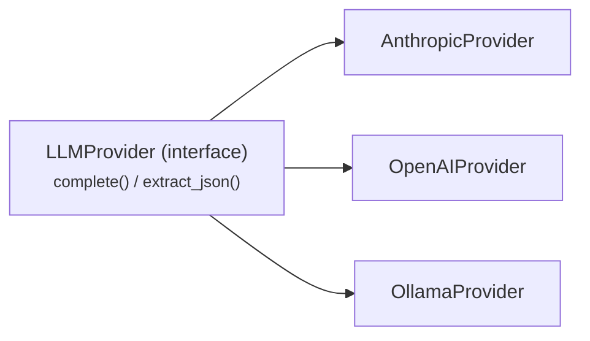
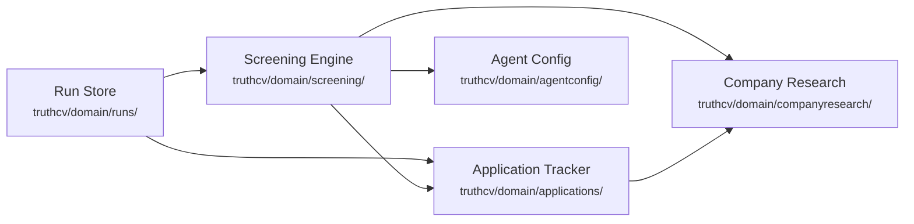
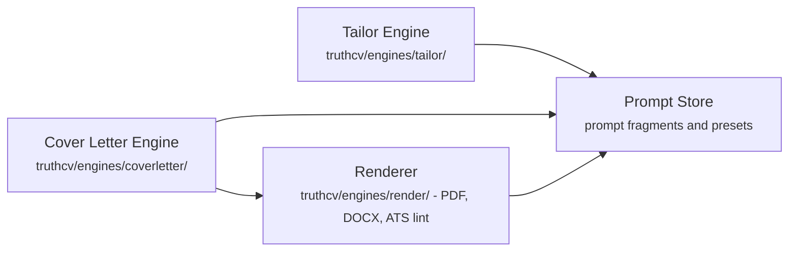
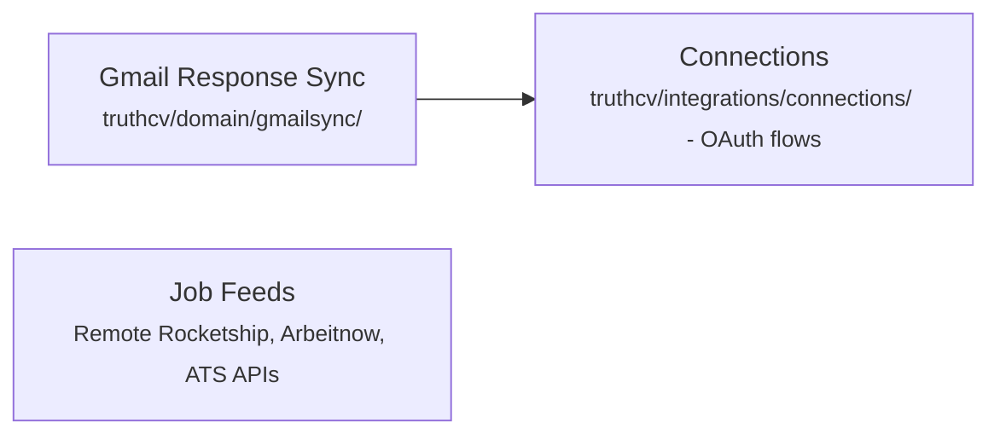
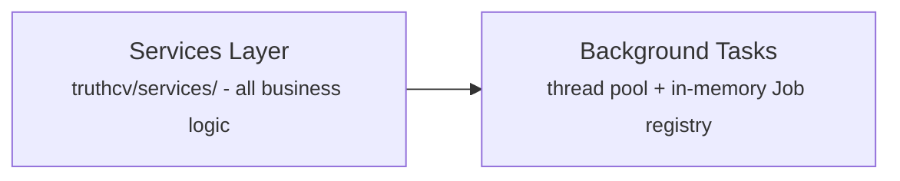
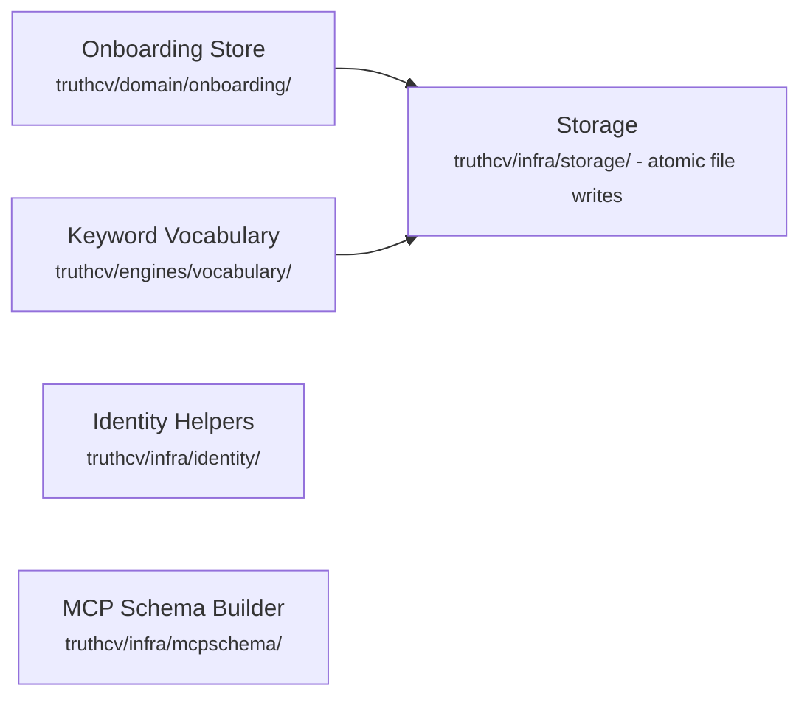

<!-- generated:start cap:overview-intro -->
# Architecture Overview

18 component(s) declared on the architecture canvas. Topology: [system-map.md](system-map.md).
<!-- generated:end cap:overview-intro -->

<!-- generated:start comp:web-ui -->
## Web UI (`web-ui`, FRONTEND)

React single-page app (web/) with client-side routing (react-router). Lands on /analytics; the manual CV flow is its own /cv route (Upload LinkedIn PDF → Review extracted truth → Paste job posting (with optional Fetch-from-URL) → Confirm inferences → Download PDF/DOCX), and Applications, Agents, Screenings and Approvals each have their own URL, so a refresh keeps the user where they were. Built by Vite into a static bundle that the API serves (its catch-all returns index.html for deep links). No auth, single-user per deployment.

**Tech:** React, Vite, TypeScript, MUI (@mui/material), Emotion (@emotion/react), react-router v8
<!-- generated:end comp:web-ui -->

<!-- generated:start comp:api -->
## API (`api`, BACKEND)

FastAPI backend (truthcv/adapters/http/) that serves the static React bundle and exposes the wizard REST routes. Its route handlers only parse and validate input, call one Services Layer function and translate the result to HTTP; the Services Layer orchestrates the pipeline: PDF upload → truth extraction → job tailoring → guardrail validation → render/download. Configured entirely from env / .env at container start (no secrets entered in the UI). Routes are split into one module per resource (truthcv/adapters/http/*_routes.py) and registered in match order by truthcv/adapters/http/routes.py; request and response models live in the truthcv/adapters/http/schemas/ package. The same process mounts the MCP tool surface from truthcv/adapters/mcp/, the only permitted import between the two adapters.

**Tech:** Python, FastAPI, Uvicorn
<!-- generated:end comp:api -->

<!-- generated:start comp:truth-store -->
## Truth Store (`truth-store`, BACKEND)

Owns truth.yaml, the single origin of all facts (truthcv/domain/truth/). Extracts text from an uploaded CV in any supported format — PDF (pypdf), DOCX (python-docx), TXT or Markdown — and builds, validates and persists the structured truth file (every role/company/date/bullet/skill tagged source:uploaded-cv with a stable id). The LLM step that turns that text into a truth file lives in the Services Layer (truthcv/services/truth_extract.py), so truthcv/domain/truth/ imports neither prompts nor providers. Legacy entries tagged linkedin-pdf remain valid. User-confirmed inferences are tagged user-confirmed.

**Tech:** Python, pypdf, PyYAML, python-docx
<!-- generated:end comp:truth-store -->

<!-- generated:start comp:guardrail-validator -->
## Guardrail Validator (`guardrail-validator`, BACKEND)

The core truthfulness guardrail (truthcv/engines/guardrail/): a pure, deterministic, scoped token-diff of a draft against truth — no LLM. validate(scopes, global_values) returns ok plus BOTH a flat unverifiable[] token list (back-compat) and structured blocked_claims grouping untraceable tokens under the specific source text (bullet) and scope id they came from, so callers can present whole-claim approve/deny. A token is verifiable if it is a stopword or appears (post-tokenization) in its own scope's allowed set (or the caller-supplied global_values — global skills for CV renders; for cover letters the Cover Letter Engine passes every truth value, including hobbies and the profile header, since a letter weaves the whole career). Render-scoped approvals are passed in by merging an approved claim's text into that scope's allowed set for a single render — the guardrail itself never mutates truth.

**Tech:** Python
<!-- generated:end comp:guardrail-validator -->

<!-- generated:start comp:llm-provider-layer -->
## LLM Provider Layer (`llm-provider-layer`, BACKEND)

Thin LLMProvider abstraction (truthcv/integrations/providers/) with three implementations — anthropic | openai | ollama — selected by the LLM_PROVIDER env var. Interface: complete(system, messages) → str and extract_json(system, messages, schema) → dict. Adding a provider later = one new file; no truthfulness logic depends on which provider is active.

**Tech:** Python, anthropic SDK, openai SDK, Ollama, httpx (Codex Responses SSE transport)

**Internal structure:**

<!-- generated:end comp:llm-provider-layer -->

<!-- generated:start comp:truth-data-volume -->
## Truth Data Volume (`truth-data-volume`, STORAGE)

The single mounted volume (./data) that persists truth.yaml and generated CVs (PDF/DOCX) across container restarts. There is no database — this flat, id-referenced file store is the entire persistence layer.

**Tech:** Docker volume, YAML files
<!-- generated:end comp:truth-data-volume -->

<!-- generated:start comp:llm-provider-service -->
## LLM Provider Service (`llm-provider-service`, CUSTOM)

External LLM inference reached by the provider layer: Anthropic or OpenAI cloud APIs (bring-your-own API key), or a local Ollama container for fully offline use (optional compose profile). Used for PDF→truth extraction, posting keyword extraction, and id-referenced tailoring/rephrasing.

**Tech:** Anthropic API, OpenAI API, Ollama
<!-- generated:end comp:llm-provider-service -->

<!-- generated:start comp:secret-store -->
## Secret Store (`secret-store`, BACKEND)

Neutral encrypted credential/secrets vault (truthcv/infra/secretstore/), extracted from the API to break the api↔providers import cycle. Resolves LLM credentials — reading data/secrets.enc (Fernet, gated on ENCRYPTION_KEY) and falling back to environment variables — and persists them via atomic tmp-rename. A leaf that uses Storage (truthcv.infra.storage data_dir) only for the data path. Depended on downward by both the API and the LLM Provider Layer.

**Tech:** Python, cryptography (Fernet)
<!-- generated:end comp:secret-store -->

<!-- generated:start comp:application-agent -->
## Application Agent (`application-agent`, BACKEND)

Unattended job-application agent running as its OWN container. Drives a nightly run through the TruthCV MCP tool surface and a remote browser MCP server, screening postings, generating guardrailed CVs and cover letters, submitting applications and writing results back to the ledger. Since the provider-agnostic cutover it is driven by TruthCV's own TypeScript agent harness (agent/harness/) rather than the Claude Code CLI, so it runs on any configured connection - Anthropic, OpenAI, OpenRouter or a local Ollama. The container remains deliberately browserless and has no access to the app data volume.

**Tech:** Docker (separate image), Node 22, Bash, MCP, jq, TypeScript, @modelcontextprotocol/sdk, Vitest
<!-- generated:end comp:application-agent -->

<!-- generated:start comp:gmail-api -->
## Gmail / Google OAuth API (`gmail-api`, CUSTOM)

External Google service used for the Gmail connection: the OAuth 2.0 browser flow (accounts.google.com authorize, oauth2.googleapis.com/token for the PKCE code exchange and refresh-token renewal) and the Gmail REST API (gmail.googleapis.com/gmail/v1/users/me/profile) read to identify the connected mailbox. Reached over HTTPS with httpx from truthcv/integrations/connections/auth/gmail.py; tokens are persisted via the Secret Store.

**Tech:** Google OAuth 2.0 (PKCE, offline access), Gmail REST API v1, httpx
<!-- generated:end comp:gmail-api -->

<!-- generated:start comp:browser-service -->
## Browser Service (`browser-service`, BACKEND)

The containerised headful Chromium (browser/ container, served by @playwright/mcp). The Application Agent drives it over in-network HTTP MCP. The API reads, opens and closes the operator browser session through its session-control endpoint via truthcv/services/browser.py.
<!-- generated:end comp:browser-service -->

<!-- generated:start comp:jev-api -->
## Jev (TypeSafe System One) API (`jev-api`, CUSTOM)

External third-party Jev (TypeSafe) service at https://api.typesafe.ai/v1/systemone. Screening posts job-posting text to it for hard-requirement cross-checks (truthcv/domain/screening/jev.py), invoked from the agent tool surface (_evaluate_jev_criteria) and the API's check_key route.

**Tech:** TypeSafe System One REST API, HTTPS
<!-- generated:end comp:jev-api -->

<!-- generated:start comp:arbeitnow-api -->
## Arbeitnow Job Board API (`arbeitnow-api`, CUSTOM)

External public Arbeitnow job-board API (https://www.arbeitnow.com/api/job-board-api). Job Feeds (truthcv/domain/jobfeeds/arbeitnow.py) fetches paginated postings from it on every feed refresh, because arbeitnow is a default, non-removable board (truthcv/domain/agentconfig/boards.py).

**Tech:** Arbeitnow public REST API, HTTPS
<!-- generated:end comp:arbeitnow-api -->

<!-- generated:start comp:application-pipeline -->
## Application Pipeline (`application-pipeline`, BACKEND)

Everything the unattended agent's work is recorded in and judged by: configuration, screening, runs, company research and the application ledger. Five parts:

APPLICATION TRACKER (truthcv/domain/applications/): owns the user's job-application records, persisted as applications.json on the Truth Data Volume. Each Application tracks a submission (Company, Website, Application URL, Submitted, Submission Type, Reached Out, To Who, Response Received, Method) and OWNS its generated documents: an editable CV and cover letter saved per-application (so old outputs are retained and traceable to the application they went out with). Applications may exist WITHOUT a job posting (General/portal submissions). CRUD helpers use atomic writes mirroring truthcv/domain/truth/store.py; re-renders edited document content via Document Generation's Renderer.

SCREENING ENGINE (truthcv/domain/screening/): screens discovered postings against the active job profile's criteria and records the verdict. Owns the hard-criteria validators (criteria.py): a posting's stated remote arrangement and any explicitly required working language are checked against the profile's remote_model / working_language, and the evidence is stored on the Screening record alongside the profile it was judged against. Posts posting text to the Jev API for hard-requirement cross-checks (jev.py).

RUN STORE (truthcv/domain/runs/): records of unattended agent runs - run lifecycle and status, counters, discovery coverage, and the per-run URL ledger with its channels and outcomes (url_ledger.py). Only the most recent runs are retained. Run guards and the source funnel live in truthcv/services/runs.py and funnel.py.

AGENT CONFIG (truthcv/domain/agentconfig/): owns the unattended agent's configuration - autonomy mode, schedule, company blocklist and watchlist, cooldown windows, job search profiles, and the global list of job boards the agent searches. Four default boards are always part of that list and cannot be removed, but any board (default or the operator's own) can be switched off, and a disabled board is not searched. Also composes the deterministic dork-style search queries handed to each run (titles, locations, remote terms and recency only; rejected role types are enforced by screening, not search), and supplies built-in search/posting URL presets for known direct boards.

COMPANY RESEARCH (truthcv/domain/companyresearch/): structured claims about a company, each with a claim type and source class, keyed by the company identity key from the identity helpers. Tracks superseded claims and open contradictions, which screening consults.

**Tech:** Python, PyYAML/JSON

**Internal structure:**

<!-- generated:end comp:application-pipeline -->

<!-- generated:start comp:document-generation -->
## Document Generation (`document-generation`, BACKEND)

Produces the tailored CV and cover letter from the truth file. Four parts:

TAILOR ENGINE (truthcv/engines/tailor/): tailors a CV to a specific posting. Extracts the posting's keywords/requirements via a provider, then selects, reorders, and rephrases ONLY entries referenced by id from truth.yaml. Detects any claim the LLM wants to add that is not already in the truth file and surfaces it as an approval checklist (confirm-inferences step); nothing unapproved reaches the CV.

COVER LETTER ENGINE (truthcv/engines/coverletter/): guardrailed cover-letter generation. build_letter() asks the LLM (via the provider layer) for a cover letter as tagged paragraphs, each declaring the factual claims it makes. Every claim is validated by the Guardrail Validator against the Truth Store; if any claim is unverifiable the letter is BLOCKED (returns {blocked: true, unverifiable, text: ""}). Otherwise the paragraph text is joined and handed to the Renderer for HTML/PDF/DOCX output. Serves /api/cover-letter together with truthcv/engines/render/.

RENDERER (truthcv/engines/render/): renders the approved CV from one Jinja-templated ATS-safe HTML source: PDF via WeasyPrint (pure-Python, single column, selectable text) and DOCX via pandoc. Runs an ATS linter before download that warns on multi-column layouts, tables, text-in-images, non-standard headings, missing contact block, and posting keywords absent from the CV. No LLM dependency.

PROMPT STORE: stores operator-editable prompt fragments and presets as JSON on the truth data volume, layered over seeded records defined in code. Fragments are atomic style blocks grouped into four display slots (voice, structure, opener, rules); any number may be combined in a preset. The default preset marker is stored separately so seeded records are never materialised on disk.

**Tech:** Python, Jinja2, WeasyPrint, pandoc

**Internal structure:**

<!-- generated:end comp:document-generation -->

<!-- generated:start comp:integrations -->
## Integrations (`integrations`, BACKEND)

Everything that reaches a third-party service on the app's behalf, other than LLM completions. Three parts:

CONNECTIONS (truthcv/integrations/connections/): the provider connection layer - a static catalog of connection cards plus per-vendor auth flows. Claude Pro/Max signs in with a PKCE paste-code flow; ChatGPT (OpenAI) signs in with an OAuth device-code flow; Gmail uses Google OAuth 2.0 PKCE. Tokens are persisted encrypted in the Secret Store and refreshed lazily on use.

GMAIL RESPONSE SYNC (truthcv/domain/gmailsync/): matches Gmail replies to tracked applications - reads the connected mailbox through the Gmail connection, produces response suggestions, can cross-check them with Jev, and records accepted ones on the Application Pipeline's tracker. Runs on demand or as a background task.

JOB FEEDS: API-backed job feeds pulled directly by TruthCV - Remote Rocketship (keyed, opt-in), Arbeitnow (keyless, a default board that is always searched), and per-company ATS APIs. Results are merged and de-duplicated by URL under one shared fetch deadline.

**Tech:** Python, httpx, Google OAuth 2.0 (PKCE)

**Internal structure:**

<!-- generated:end comp:integrations -->

<!-- generated:start comp:orchestration -->
## Orchestration (`orchestration`, BACKEND)

All business logic plus the background executor that runs it off the request thread. Two parts:

SERVICES LAYER (truthcv/services/): both adapters, the HTTP API (truthcv/adapters/http/) and the MCP tool surface (truthcv/adapters/mcp/), parse input, call one service function, and translate its result or a services.errors exception into their wire format. Services never import the adapters or FastAPI, and receive the LLM provider (or a provider factory) from the caller. The layering is enforced by import-linter in pyproject.toml.

BACKGROUND TASKS (truthcv/infra/background_tasks/): a bounded background job executor - a shared thread pool (MAX_WORKERS=4) plus an in-memory, thread-safe registry of Job records. Callers submit a zero-argument callable via submit(kind, fn); it runs on a worker thread and its outcome (result or exception) is recorded on the returned Job. get()/list_jobs() poll registry state. The registry is in-memory only - jobs are not persisted across restarts. Used for Gmail sync and feed refresh.

**Tech:** Python, concurrent.futures ThreadPoolExecutor, import-linter

**Internal structure:**

<!-- generated:end comp:orchestration -->

<!-- generated:start comp:storage -->
## Storage & Shared Leaves (`storage`, BACKEND)

The lowest layer: file storage and the small shared helpers every other component may depend on. Five parts:

STORAGE (truthcv/infra/storage/): lowest-level file storage - data_dir() resolution (DATA_DIR, default ./data) and atomic, locked file writes used by every store. Imports nothing first-party. The only component that touches the Truth Data Volume.

ONBOARDING STORE (truthcv/domain/onboarding/): first-run onboarding state - records which setup steps are complete, such as a provider being ready and a CV profile existing. The API reads and updates it through truthcv/services/onboarding.py.

KEYWORD VOCABULARY (truthcv/engines/vocabulary/): the shared keyword data used by tailoring, the guardrail and the renderer's ATS keyword check.

IDENTITY HELPERS (truthcv/infra/identity/): stdlib-only identity helpers shared by every layer - company identity keys and name validation (company.py) and posting-URL validation, normalisation and dedupe keys (url.py). Imports nothing first-party.

MCP SCHEMA BUILDER (truthcv/infra/mcpschema/): stdlib-only MCP input-schema builder that derives each MCP tool's JSON input schema from its Python signature. Used by the MCP tool surface and by the API's MCP endpoints. Imports nothing first-party.

**Tech:** Python (stdlib only for the infra leaves)

**Internal structure:**

<!-- generated:end comp:storage -->
